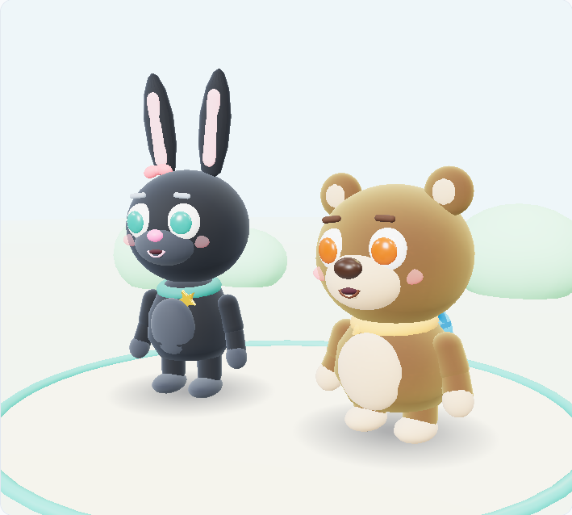
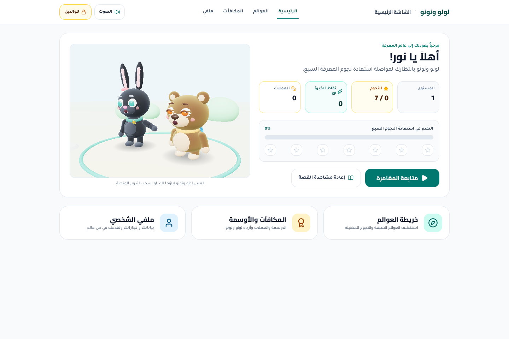
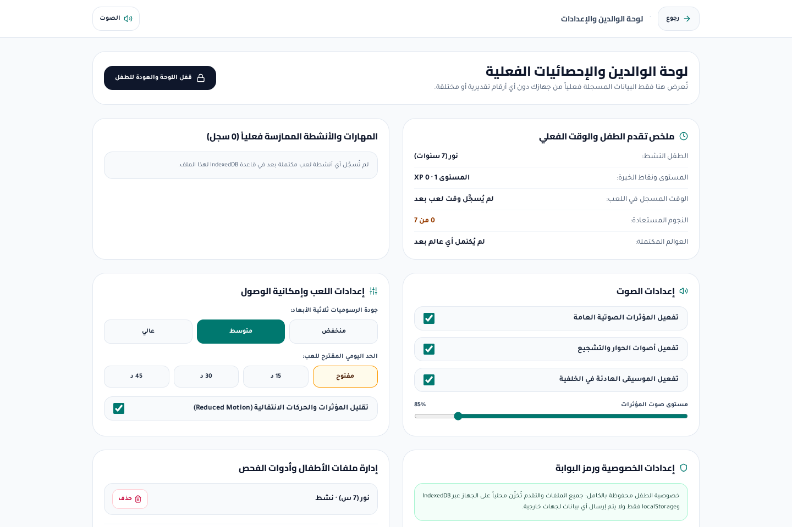

# مغامرات لولو ونونو – عالم المعرفة
### Lulu and Nunu – World of Knowledge

لعبة تعليمية تفاعلية ثلاثية الأبعاد باللغة العربية (`RTL`) للأطفال من عمر **4 إلى 10 سنوات**، مبنية بـ **React 19 + TypeScript + Three.js + Tailwind CSS v4**، مصممة للعمل **محلياً ودون إنترنت (`Offline-First PWA`)** مع جاهزية التغليف لاحقاً عبر **Capacitor** لنظام **Android**.

---

## قصة اللعبة والشخصيات
انطلقت **لولو** (الأرنبة السوداء اللطيفة والذكية) و**نونو** (الدب البني المرح) في رحلة لاستعادة **النجوم السبع للمعرفة** عبر سبعة عوالم تعليمية:
1. عالم الحروف واللغة العربية (*نجمة البيان*)
2. عالم الأرقام والحساب (*نجمة الحساب*)
3. مملكة الحيوانات (*نجمة الطبيعة*)
4. عالم العلوم والاكتشاف (*نجمة الاكتشاف*)
5. عالم الذكاء والألغاز (*نجمة الحكمة*)
6. عالم اللغة الإنجليزية (*نجمة اللغات*)
7. عالم الفن والإبداع (*نجمة الإبداع*)

---

## لقطات فعلية من المشروع (`reports/`)

| مختبر الشخصيات 3D (المرحلة 1) | الشاشة الرئيسية (المرحلة 2) | خريطة العوالم السبعة | لوحة الوالدين |
|---|---|---|---|
|  |  |  |  |

---

## الحالة الحالية باختصار
- **المرحلة 0 (البيئة والمعمارية):** مكتملة ومعتمدة (`COMPLETED — Verified`)
- **المرحلة 1 (الشخصيات ثلاثية الأبعاد ومختبر الشخصيات):** معتمدة مشروطاً (`CONDITIONALLY APPROVED`)
- **المرحلة 2 (الشاشات الـ 14 الأساسية والتنقل):** الشاشات مبنية واللقطات ملتقطة، وحالتها **`IN REVIEW`** ريثما يُستكمل تشغيل حزمة `tests/phase2` الكامل وكتابة `PHASE2_QA_REPORT.md`
- **المراحل 3–9 (العوالم السبعة):** مخططة ولم تُنفذ بعد (`PLANNED — Not implemented`)

للتفاصيل الكاملة راجع [`PROJECT_STATUS.md`](./PROJECT_STATUS.md) و[`docs/handover/AI_HANDOVER.md`](./docs/handover/AI_HANDOVER.md).

---

## التشغيل السريع

```bash
npm ci
npm run dev       # خادم التطوير على المنفذ 3000
npm run lint      # فحص TypeScript (tsc --noEmit)
npm run build     # بناء الإنتاج في dist/
npm run test:e2e  # اختبارات Playwright (تتطلب npx playwright install chromium أول مرة)
```

### أوضاع التحقق الخاصة
- تطبيق اللعبة الرئيسي: `http://localhost:3000/`
- مختبر الشخصيات ثلاثية الأبعاد: `http://localhost:3000/?mode=character-lab`
- تشخيص المرحلة صفر: `http://localhost:3000/?mode=phase0`

---

## التوثيق والبدء للـ AI والمطورين
- فهرس التوثيق الشامل: [`docs/README.md`](./docs/README.md)
- تسليم المشروع والاستئناف الفوري للذكاء الاصطناعي: [`docs/handover/AI_HANDOVER.md`](./docs/handover/AI_HANDOVER.md) و[`docs/handover/QUICK_RESUME.md`](./docs/handover/QUICK_RESUME.md)
- خارطة الطريق والمراحل (0–16): [`docs/roadmap/MASTER_ROADMAP.md`](./docs/roadmap/MASTER_ROADMAP.md)
- الخصوصية وسلامة الطفل: [`docs/security/CHILD_SAFETY.md`](./docs/security/CHILD_SAFETY.md)
